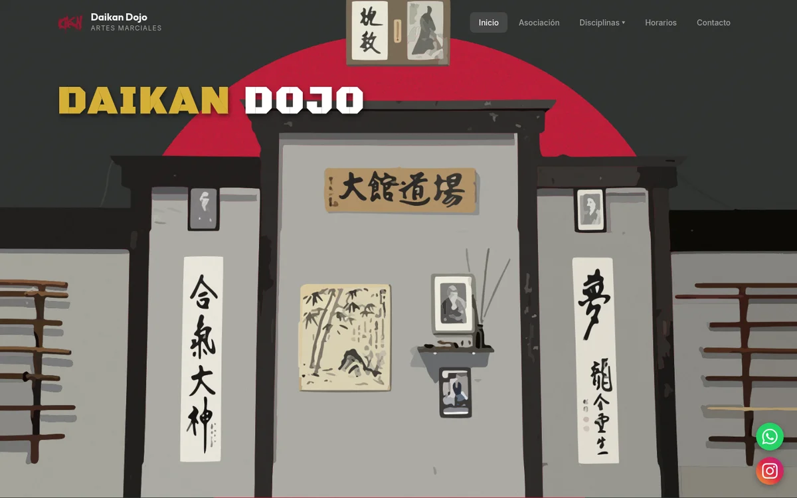
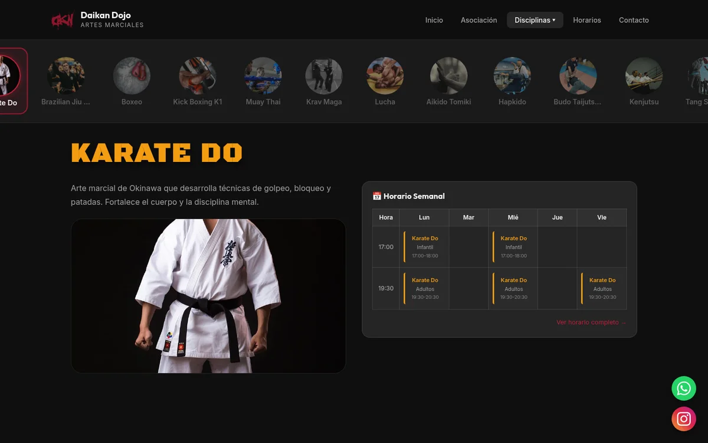
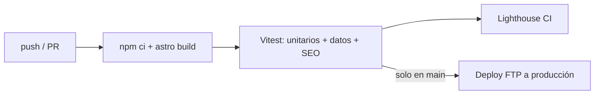

# Daikan Dojo — web de una escuela de artes marciales

[](https://github.com/juan33133/daikandojo/actions/workflows/deploy.yml)


[](LICENSE)

Web en producción de **[Daikan Dojo](https://daikandojo.com)**, una asociación de artes marciales de Málaga con 12 disciplinas y clases para niños y adultos. La diseñé, la desarrollé y la mantengo para un cliente real.

| Inicio | Página de disciplina |
|---|---|
|  |  |

## Qué resuelve

El dojo necesitaba una web rápida, fácil de encontrar en Google y que **una persona sin conocimientos técnicos pudiera actualizar**. Los horarios y las disciplinas viven en dos ficheros JSON ([`src/data/`](src/data)) y todas las páginas se generan a partir de ellos:

- **1 JSON → 12 páginas**: cada disciplina tiene su propia URL indexable, con su descripción y su horario filtrado.
- **Sitio 100 % estático**: HTML pre-renderizado, sin servidor ni base de datos, alojado en un hosting compartido barato.
- **JavaScript mínimo**: solo para el carrusel, la animación 3D y la navegación entre disciplinas sin recargar (`history.pushState`).

## Stack

| Área | Tecnología |
|---|---|
| Framework | [Astro 6](https://astro.build) (generación estática), TypeScript |
| Estilos | CSS propio (custom properties, sin framework) |
| Tests | Vitest + `node-html-parser`, cobertura con V8 |
| CI/CD | GitHub Actions → build, tests, Lighthouse → despliegue por FTP |
| SEO | Sitemap automático, JSON-LD (`LocalBusiness`, `Course`, `BreadcrumbList`), Open Graph |

## Calidad y testing

Los tests se ejecutan en cada push y cada pull request. **El despliegue a producción solo ocurre si todos pasan.**

```
tests/
├── horarios.test.ts   # Unitarios de la lógica de horarios (src/lib/horarios.ts)
├── seo-lib.test.ts    # Unitarios del recorte de meta descriptions
├── data.test.ts       # Integridad de los JSON: ids únicos, imágenes existentes, horas válidas…
└── seo.test.ts        # Auditoría SEO sobre el HTML generado en dist/
```

- **Tests de datos**: como los JSON se editan a mano, comprueban que una errata (una imagen que no existe, una clase que termina antes de empezar, una actividad mal escrita) se detecte en CI y no llegue a publicarse.
- **Auditoría SEO automatizada**: recorre todas las páginas generadas y comprueba título único, longitud de la meta description, canonical, un único `<h1>`, `alt` en las imágenes, `og:image` absoluta y existente, JSON-LD válido y que el sitemap coincida con las páginas indexables.
- **Lighthouse CI** audita rendimiento, accesibilidad, buenas prácticas y SEO en cada ejecución ([`lighthouserc.json`](lighthouserc.json)).

```bash
npm ci
npm run dev            # servidor de desarrollo
npm run check          # build + todos los tests
npm run test:coverage  # tests con informe de cobertura
```

## Pipeline



El job de despliegue publica **exactamente el mismo build que se ha testeado** (se pasa como artefacto entre jobs) en lugar de recompilar.

## Decisiones técnicas

- **Astro en lugar de React/Next**: el contenido es casi estático; Astro envía 0 KB de JS por defecto, lo que da buenos Core Web Vitals en un hosting compartido.
- **JSON como "CMS"**: para un cliente pequeño, un CMS headless añadía coste y complejidad. Editar un JSON está validado por los tests.
- **Lógica fuera de los componentes**: el filtrado de horarios vive en [`src/lib/`](src/lib) como funciones puras, para poder testearlo sin renderizar páginas.
- **Optimización de imágenes**: imágenes con dimensiones explícitas (evita saltos de diseño) y `loading="lazy"`; la imagen más pesada se pasó de PNG de 6,8 MB a WebP de 110 KB.

## Estructura

```
src/
├── components/   # Header, Hero, Footer, tarjetas…
├── data/         # disciplinas.json, horarios.json (contenido editable)
├── layouts/      # BaseLayout: metadatos SEO, Open Graph y JSON-LD
├── lib/          # Lógica pura y testeada
├── pages/        # Rutas (incluida /disciplinas/[id] generada dinámicamente)
└── styles/
```

## Licencia

[MIT](LICENSE) © Juan Carballal
